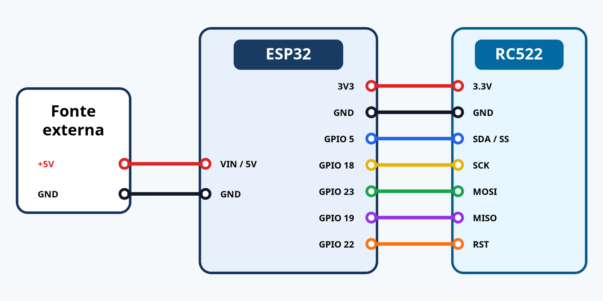
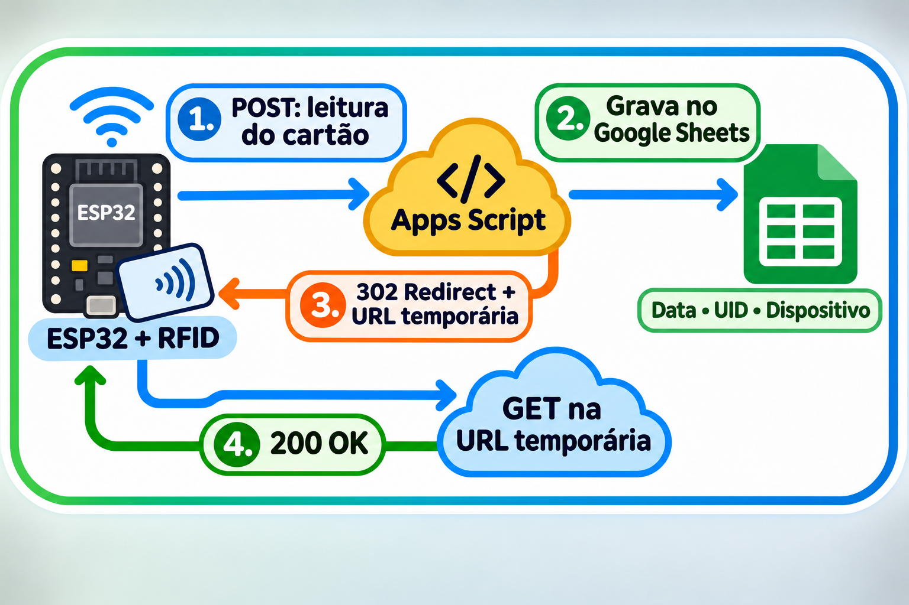
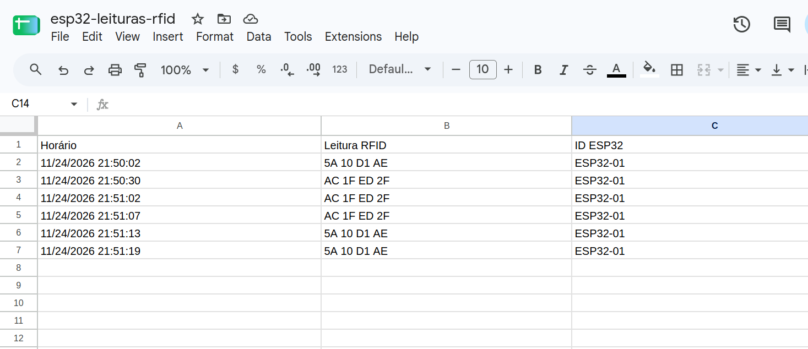

# ESP32 RFID Logger com Google Sheets

Projeto ESP-IDF que utiliza um leitor RFID RC522 para identificar cartões e
registrar as leituras em uma planilha do Google Sheets por meio de um Web App
do Google Apps Script.

Ao aproximar um cartão, o ESP32 lê seu UID e envia uma requisição HTTP pela
rede Wi-Fi. A planilha armazena o horário da leitura, o UID e o identificador
do dispositivo.

## Hardware

- ESP32
- Módulo leitor RFID RC522
- Cartão ou tag compatível com o RC522
- Fonte de alimentação de 5 V ou cabo USB
- Jumpers

### Ligações

| Componente | Pino do componente | Conexão         |
| ---------- | ------------------ | --------------- |
| RC522      | 3.3V               | 3V3 do ESP32    |
| RC522      | GND                | GND do ESP32    |
| RC522      | SDA / SS           | GPIO5 do ESP32  |
| RC522      | SCK                | GPIO18 do ESP32 |
| RC522      | MOSI               | GPIO23 do ESP32 |
| RC522      | MISO               | GPIO19 do ESP32 |
| RC522      | RST                | GPIO22 do ESP32 |

> O RC522 deve ser alimentado com 3,3 V. Se uma fonte externa for utilizada
> para alimentar o ESP32 pelo pino VIN/5V, conecte também os GNDs em comum.



## Funcionamento

O ESP32 conecta-se à rede Wi-Fi e monitora continuamente o leitor RC522.
Quando um cartão é detectado, seu UID é colocado em uma fila para que o envio
HTTP aconteça sem bloquear a leitura RFID.

O firmware envia ao Web App um objeto JSON com o token de acesso, o UID lido e
o identificador do ESP32. O Google Apps Script valida a requisição e adiciona
uma nova linha à planilha. O cliente também trata o redirecionamento HTTP do
Apps Script e considera o registro concluído quando recebe uma resposta `OK`.



O resultado na planilha contém o horário, a leitura RFID e o dispositivo que
enviou o registro.



## Configuração

Antes de compilar, ajuste as seguintes constantes:

- `WIFI_SSID` e `WIFI_PASSWORD` em `main/main.c` com os dados da rede Wi-Fi;
- `API_URL` em `main/http_client.c` com a URL do Web App publicado;
- `API_TOKEN` com o mesmo token validado pelo Google Apps Script;
- `DEVICE_ID` com o nome usado para identificar este ESP32 na planilha.

O Web App deve aceitar o JSON enviado pelo firmware, gravar os campos na
planilha e retornar o texto `OK` quando a operação for concluída.

## Compilar e gravar

Requer o ESP-IDF configurado no terminal. A dependência do driver RC522 é
obtida automaticamente pelo IDF Component Manager durante a compilação.

```bash
idf.py set-target esp32
idf.py build
idf.py -p /dev/ttyUSB0 flash monitor
```

Substitua `/dev/ttyUSB0` pela porta serial da sua placa.
